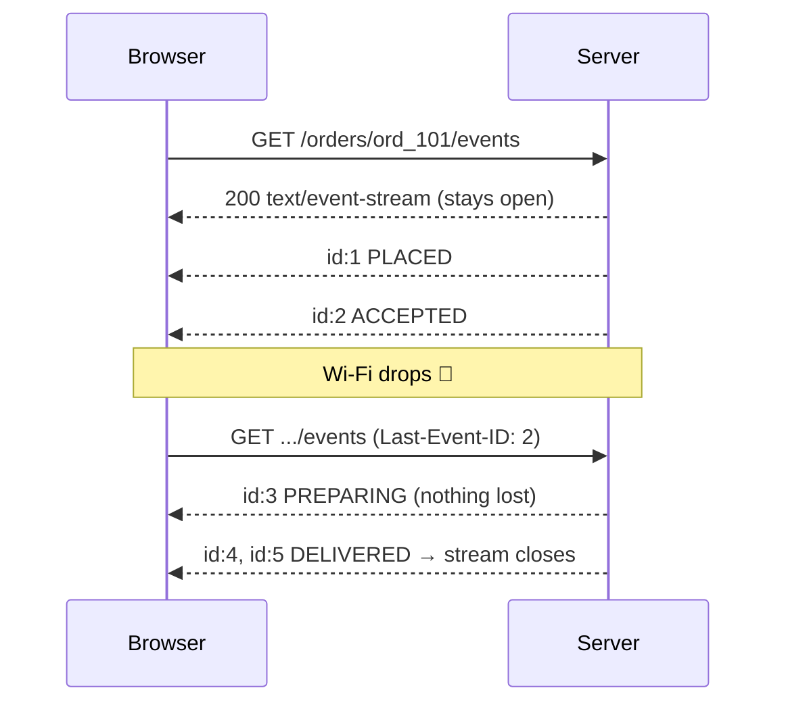

# Exercise 03 — Server-Sent Events (SSE)

**Time:** ~40 min  **Port:** 8083  **You'll learn:** one-way server push over plain HTTP, the SSE wire format, resuming after a disconnect

## The story
Long polling worked, but every update still costs a brand-new request. What if the server just kept **one** response open and wrote to it whenever something happened?

That's SSE. It is literally a response with `Content-Type: text/event-stream` that never ends:

### The SSE Wire Protocol
SSE is plain UTF-8 text. Each event has fields separated by newlines, ending with a **blank line** (`\n\n`):

```text
id: 1
event: status
data: {"status":"PLACED","version":1}

id: 2
event: status
data: {"status":"ACCEPTED","version":2}

```

- **EventSource:** Built right into every web browser (`const es = new EventSource('/orders/101/events')`) — no external WebSocket client libraries required.
- **Auto-Reconnect & `Last-Event-ID`:** If the network drops, the browser automatically reconnects and includes the `Last-Event-ID: <id>` header. The server uses this to replay any missed events from its history.
- **HTTP 204:** When the order is `DELIVERED` and all events are acknowledged, if the client attempts to reconnect, the server responds with **`204 No Content`**, which tells the browser's `EventSource` to permanently stop reconnecting.
- **Comments & Keep-Alive:** Lines starting with a colon (`: keep-alive\n\n`) are comments ignored by `EventSource`. Servers send them periodically to prevent proxies and load balancers from killing "idle" connections.



## Run it
```bash
java SseServer.java        # terminal 1
java Check.java            # terminal 2
curl -N localhost:8083/orders/ord_101/events   # -N = don't buffer; watch raw events appear
```
Then open **http://localhost:8083** → *Place order* → *Simulate network drop* while it's cooking.

## TODOs in `SseServer.java`
| # | Method | What |
|---|---|---|
| 1 | `writeEvent` | Format `id/event/data` + blank line, and **flush** |
| 2 | `stream` | Headers, replay from `Last-Event-ID`, wait for changes, keep-alive comments, close at the end, **204** when nothing is left |

## Think & answer
1. SSE vs long polling: count the HTTP requests for one order in each. What's the same, what's better?
   - **Request Count:** Long polling takes **at least 5 separate HTTP requests** for 5 status changes (plus extra requests whenever the 30 s polling timeout elapses). SSE takes **exactly 1 HTTP request** total.
   - **What's the same:** Both are unidirectional (server-to-client push) over standard HTTP, both work over port 80/443 without special firewall rules, and both keep a connection held open.
   - **What's better in SSE:** Far lower protocol overhead (no repeated request headers, TLS renegotiation, or cookies sent on every status update), zero connection churn, and automated browser reconnection with `Last-Event-ID` tracking built into `EventSource`.

2. Why does the server need to keep a **history** to support `Last-Event-ID`? What would you use instead of an in-memory list in production? (Hint: Redis Streams, Kafka)
   - When a mobile device briefly drops network connectivity (e.g. entering an elevator) and reconnects with `Last-Event-ID: 2`, the server needs history to replay missed events (3, 4) so the client timeline doesn't skip steps.
   - In production with multiple server instances, an in-memory list fails if the reconnect hits a different server. We would use a distributed append-only log with ID-based replay, such as **Redis Streams** (`XREAD ... ID`), **Apache Kafka**, or an append-only database table (`WHERE id > :lastEventId`).

3. Why send `: keep-alive` comments? Who is closing "idle" connections?
   - Intermediate infrastructure (AWS ALBs, Nginx reverse proxies, cloud firewalls, NAT gateways) automatically terminate TCP connections that have no data flow for 30–60 seconds to clean up idle resources.
   - SSE lines starting with a colon (`: keep-alive\n\n`) are comments ignored by the browser's `EventSource`, but they generate active TCP packets that reset proxy idle timers.

4. SSE is server → client only. How does the client send something back? Is that a problem for an order tracker? For a chat?
   - To send data to the server, the client makes standard HTTP `POST`/`PATCH` requests.
   - For an **order tracker**, this is ideal: 99% of data flows from server to client (status updates), while customer actions (cancel, add notes) are rare and fit clean REST endpoints.
   - For **chat**, high-frequency two-way messages and typing indicators would require repeated HTTP POSTs, introducing noticeable overhead and latency; **WebSockets** are much better suited for bidirectional messaging.

5. Browsers allow only ~6 HTTP/1.1 connections per domain. What happens with 7 open tabs of the tracker? How does HTTP/2 change that?
   - Under **HTTP/1.1**, each open SSE tab holds 1 of the 6 available TCP connection slots. Opening 6 tabs exhausts the browser limit; the 7th tab hangs waiting, and regular `fetch()` calls or image downloads to that domain are blocked.
   - Under **HTTP/2 (and HTTP/3)**, connections are **multiplexed** over a single underlying TCP connection. Dozens of SSE streams and standard requests coexist concurrently over one connection without blocking.

6. Name two real products that could use SSE instead of WebSockets. (ChatGPT-style token streaming is one — why does it fit?)
   - **ChatGPT / LLM Token Streaming:** The user sends one prompt via `POST`, and the server generates and streams tokens one by one for 10–30 seconds. The communication is strictly one-way, and SSE avoids the complexity and overhead of WebSockets.
   - **Stock/Crypto Live Price Ticker (e.g. TradingView read-only widget) or Live Sports Scores (e.g. ESPN):** Millions of viewers receiving real-time ticks from the server without ever sending messages back.

## Stretch
- Add a second event type `eta` (`event: eta`, `data: {"minutes": 12}`) sent every 2 s while `OUT_FOR_DELIVERY`, and show it on the page with `es.addEventListener('eta', ...)`.
- Send `retry: 10000` once at the start of the stream and watch the browser's reconnect delay change.
