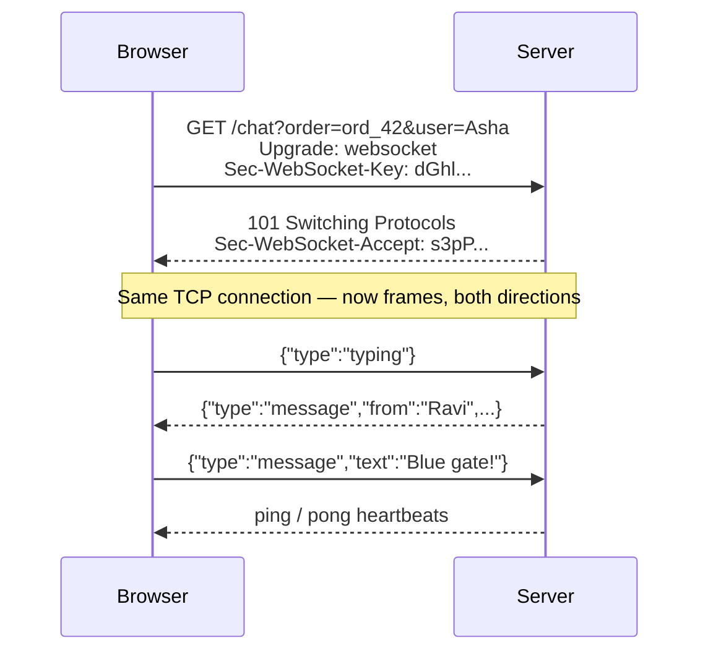

# Exercise 04 — WebSockets (built from raw sockets)

**Time:** ~60 min  **Port:** 8084  **You'll learn:** the HTTP upgrade handshake, frames, full-duplex messaging, rooms & broadcast

## The story
The rider can't find the customer's gate. They need to **chat** — both sides sending at any moment, with "typing…" indicators. SSE is one-way; polling is too slow. Time for a WebSocket.

We build the server on a plain `ServerSocket` (no Spring, no Netty) so you can see there's no magic:



## Run it
```bash
java ChatServer.java                 # terminal 1
java Check.java                      # terminal 2
```
Then: open **http://localhost:8084** in two tabs, join the same order, chat. Also try the terminal client:
```bash
java ChatClient.java ord_42 Ravi
```
Open browser DevTools → Network → click the `chat` request → **Messages** tab. You'll see every frame.

## TODOs
| # | Where | What |
|---|---|---|
| 1 | `ChatServer.acceptKey` | `Base64(SHA-1(key + GUID))` — the whole handshake "proof" |
| 2 | `ChatServer.onOpen` | Join the room, broadcast "joined" + online list |
| 3 | `ChatServer.onMessage` | Route `message` (to all) and `typing` (to all but sender) |
| 4 | `ChatServer.onClose` | Leave the room, broadcast "left" |
| 5 | `ChatClient.main` | Connect with the JDK's `WebSocket` client and send lines |

Read `Ws.readFrame` / `Ws.writeFrame` too — 40 lines that *are* the WebSocket protocol.

## Think & answer
1. Why does WebSocket start as HTTP at all? (Think: port 443, firewalls, proxies, existing load balancers.)
   - Corporate firewalls, reverse proxies, and NAT gateways generally allow traffic on ports 80 (HTTP) and 443 (HTTPS), while blocking arbitrary non-HTTP TCP ports.
   - Starting as a standard HTTP `GET` with an `Upgrade: websocket` header allows the handshake to traverse existing networking infrastructure, API gateways, and firewalls without requiring custom open ports. Once the server returns `101 Switching Protocols`, both sides switch the exact same TCP socket to binary frame mode.

2. Why must browser→server frames be **masked**? (Search: "cache poisoning" attack on proxies.)
   - To prevent **cache poisoning attacks** on intermediate transparent proxies.
   - If an unmasked frame sent by a malicious browser script happened to contain bytes formatted like an HTTP `GET /page.html HTTP/1.1`, an intermediary proxy that failed to understand the WebSocket upgrade could misinterpret the payload as an HTTP request and cache malicious responses for subsequent users.
   - XOR-masking client frames with a 4-byte random key ensures data on the wire is scrambled and cannot be interpreted as an HTTP command by intermediate proxies. Server→client frames are unmasked because the server is trusted.

3. Our `ROOMS` map lives in one JVM. With 3 server instances behind a load balancer, Asha lands on server A and Ravi on server B. What breaks? How do Redis Pub/Sub or Kafka fix it? What are "sticky sessions"?
   - **What breaks:** Server A only holds Asha's TCP socket; Server B only holds Ravi's TCP socket. When Ravi sends a message, Server B has no local reference to Asha, so Asha never receives it.
   - **How Redis Pub/Sub / Kafka fixes it:** Servers publish room messages to a distributed message broker (e.g. Redis channel `room:ord_42`). Every server instance subscribes to active room channels; when Server A receives the Redis event, it broadcasts to Asha.
   - **Sticky sessions:** Routes requests from the *same client* to the same server instance. Sticky sessions do not fix multi-user chat because Asha and Ravi are two separate users.

4. The server holds one open TCP connection per user. Roughly how many can one box hold, and what limits it (memory, file descriptors, threads)?
   - A tuned Linux server can hold **100,000 to 1,000,000+** concurrent idle WebSocket connections.
   - **File Descriptors:** Each socket requires a file descriptor. The OS default (`ulimit -n 1024`) must be tuned up into the hundreds of thousands.
   - **Memory:** Each TCP socket requires kernel read/write socket buffers (typically 4 KB–16 KB). 100,000 connections require ~1.5 GB of RAM.
   - **Threads:** Traditional 1-thread-per-connection architectures exhaust memory at a few thousand threads (1 MB stack each). Modern servers use **Java 21 virtual threads** or event loops (Netty / epoll) so parked connections consume near-zero CPU and minimal memory.

5. Ping/pong: who should send pings, and what happens to the room if a phone goes into a tunnel and never sends a Close frame?
   - The **server** sends periodic `PING` control frames (e.g. every 20–30 s).
   - If a phone abruptly enters a subway tunnel, the connection enters a "half-open" state where no `CLOSE` or `FIN` packet is transmitted. Without heartbeats, the server would keep the dead socket and user in the room indefinitely.
   - When the client fails to answer with a `PONG` within a timeout (e.g. 10 s), the server terminates the socket, cleans up the room, and broadcasts `<user> left`.

6. Chat over WebSocket vs chat over "POST to send + SSE to receive". When is the second one actually better?
   - **POST + SSE is better when:**
     - You want standard HTTP middleware for authentication, rate-limiting, and caching on outgoing messages.
     - You want natural idempotency on message sends via `Idempotency-Key` headers.
     - Your clients run in restrictive corporate environments where WebSockets are blocked by proxies, but HTTP/2 SSE works seamlessly with multiplexing.
     - Built-in automatic reconnection with `Last-Event-ID` message replay is needed without building custom application-level heartbeat protocols.

## Stretch
- **Heartbeat:** every 20 s, send a PING to each client; if no PONG within 10 s, close it and run `onClose`.
- **History:** keep the last 20 messages per room and replay them to whoever joins.
- **Reconnect:** make the browser page reconnect with exponential backoff (1 s, 2 s, 4 s… max 30 s) when the server restarts.
