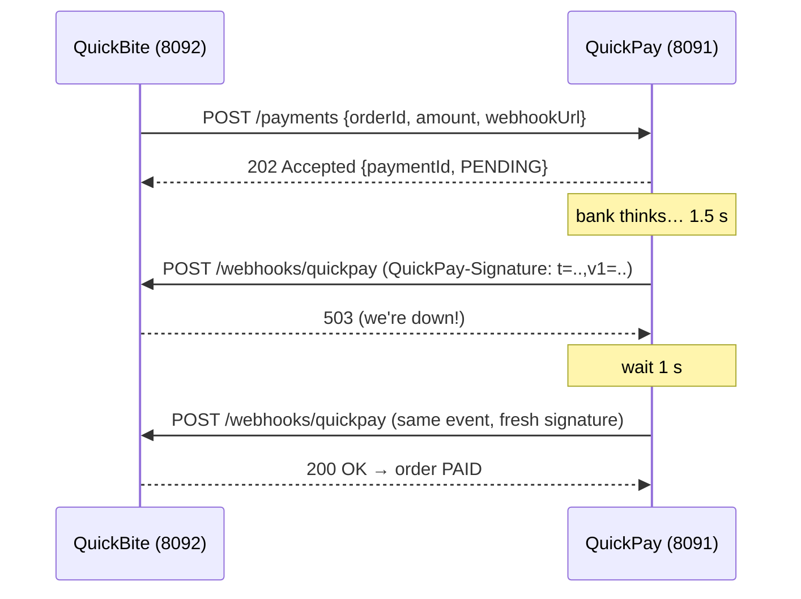

# Exercise 05 — Webhooks (sending *and* receiving)

**Time:** ~60 min  **Ports:** 8091 (gateway), 8092 (merchant)  **You'll learn:** server-to-server callbacks, HMAC signatures, replay protection, retries with backoff, at-least-once delivery & idempotent receivers

## The story
QuickBite charges customers through **QuickPay** (a pretend Razorpay/Stripe). Charging a card takes time, so QuickPay answers `202 Accepted` immediately and **calls QuickBite back** when the bank decides.

That callback is a webhook: *"don't call us, we'll call you."* It's just an HTTP POST — but from the *server* to *your* server. Which means: anyone on the internet can also POST to your webhook URL.



## Run it
```bash
java PayGateway.java      # terminal 1
java MerchantApp.java     # terminal 2
java Check.java           # terminal 3
curl -s -X POST localhost:8092/orders -d '{"amount":499}'   # then GET the order a couple of times
curl -s localhost:8091/deliveries                            # every delivery attempt
```

## TODOs
| # | File | What |
|---|---|---|
| 1 | `PayGateway.signatureHeader` | `t=<ts>,v1=HMAC_SHA256(secret, "<ts>.<body>")` |
| 2 | `PayGateway.deliverWithRetries` | POST, and on failure retry after 1 s, 2 s, 4 s, 8 s |
| 3 | `MerchantApp.receiveWebhook` | Verify signature (constant-time) + reject stale timestamps → **401** |
| 4 | `MerchantApp.receiveWebhook` | Ignore duplicate event ids — but still answer **200** |
| 5 | `MerchantApp.receiveWebhook` | Update the order, respond fast |

## Break it on purpose
Restart in chaos mode and read both logs side by side:
```bash
java PayGateway.java --duplicate     # every event is delivered twice
java MerchantApp.java --flaky        # first 2 webhooks get 503
```
Then check `curl localhost:8092/stats` and `curl localhost:8091/deliveries`.

## How Webhooks Work (Architecture & Security)

### 1. The Core Idea: "Don't Call Us, We'll Call You"
- **Polling:** The merchant repeatedly queries `GET /payments/{id}` every 2 seconds. Most calls return "PENDING", burning server CPU, bandwidth, and battery.
- **Webhook:** The merchant passes a `webhookUrl` to the payment gateway once and says: *"Call me as soon as the bank settles."* When the event occurs, the gateway makes an HTTP `POST` to the merchant's URL.

### 2. End-to-End Execution Flow
1. **Initiate Payment (Non-blocking):** QuickBite calls `POST /payments` on QuickPay with the order details and `webhookUrl`.
2. **Immediate Acknowledgment:** QuickPay responds with **`202 Accepted`** (`status: PENDING`) immediately — never blocking for slow bank networks.
3. **Asynchronous Settlement:** QuickPay processes the charge with the card network/bank (takes 1–3 seconds).
4. **The Webhook Callback:** QuickPay signs the payload and makes an HTTP `POST` to QuickBite's `webhookUrl`.
5. **Verification & Update:** QuickBite verifies the cryptographic signature in constant time, deduplicates the event ID, updates the order to `PAID`, and answers with **`200 OK`**.

### 3. The Security Layer (Defending a Public Endpoint)
Because webhook receivers are publicly accessible over the internet, anyone could attempt to POST fake `"payment.succeeded"` events. We secure it with three defenses:

- **HMAC-SHA256 (Authenticity & Integrity):** Both servers share an out-of-band secret (`WEBHOOK_SECRET`). The gateway signs the payload using `HMAC_SHA256(secret, t + "." + rawBody)`. If an attacker tampers with even a single byte of the payload or amount, the signature fails verification (`401 Unauthorized`).
- **Timestamp `t` (Stopping Replay Attacks):** Including the timestamp `t` inside the signed payload cryptographically locks the signature to a point in time. The merchant checks `|now - t| <= 300` seconds (5 min). An attacker who intercepts a legitimate signed payload cannot replay it hours or weeks later.
- **Constant-Time Comparison (`MessageDigest.isEqual`):** Standard `String.equals()` short-circuits on the first mismatched byte, allowing attackers to guess signatures byte-by-byte via microsecond timing differences (timing attacks). `MessageDigest.isEqual` always executes in constant time.
- **Raw Body Verification:** Verification is computed strictly against the **raw body bytes**, not re-serialized JSON (since JSON key order and spacing are non-deterministic).

### 4. The Reliability Layer (Retries & Idempotency)
- **Exponential Backoff:** If the merchant is down (`503`) or unreachable, the gateway retries with growing intervals (`1s, 2s, 4s, 8s`).
- **At-Least-Once Delivery & Idempotent Consumer:** Network retries mean the same event ID will arrive more than once. The merchant records processed event IDs in an atomic set (`PROCESSED_EVENTS.add(eventId)`).
- **Why answer 200 on duplicates?** Gateways interpret any non-2xx response (including 409 or 400) as a delivery failure and will continue retrying. Answering **`200 OK`** acknowledges receipt and tells the gateway to stop retrying.

### Summary Checklist for System Design Interviews

| Security / Design Need | Solution Implemented |
|---|---|
| **Asynchronous Push** | Gateway triggers `POST /webhooks/quickpay` after bank settlement. |
| **Tamper Protection** | `QuickPay-Signature: t=..,v1=HMAC_SHA256(secret, t + "." + rawBody)`. |
| **Replay Protection** | Verified `|now - t| <= TOLERANCE_SECONDS` (5 mins). |
| **Timing Attack Defense** | `MessageDigest.isEqual()` constant-time byte comparison. |
| **Gateway Retries** | Exponential backoff (`1s, 2s, 4s, 8s`) up to `MAX_ATTEMPTS = 5`. |
| **Duplicate Delivery** | Atomic `PROCESSED_EVENTS.add()`; duplicates answered with `200 OK`. |

---

## Think & answer
1. Webhook vs the merchant **polling** `GET /payments/{id}`. Why do gateways offer both? When do you need the poll anyway? (Hint: what if *all 5* retries fail during your deploy?)
   - **Why both:** Webhooks provide real-time, event-driven push notifications with zero wasted polling traffic for 99.9% of normal operations. Polling (`GET /payments/{id}`) acts as the essential **reconciliation fallback**.
   - **When you need polling:** If the merchant server experiences an extended outage, network partition, or deployment failure that exhausts all gateway retry attempts, the webhook is permanently dropped. A scheduled background reconciliation job (e.g., polling every 5–10 minutes for orders in `PENDING_PAYMENT` > 1 min) queries the gateway to sync final payment states.

2. Why HMAC and not just a secret token in a header like `X-Secret: abc`? What does HMAC prove that a token doesn't?
   - A static header like `X-Secret: abc` proves *authentication* (who sent it), but provides **zero integrity protection**. An attacker, proxy, or rogue gateway could intercept the request and tamper with the body (e.g. flipping `"status": "FAILED"` to `"status": "SUCCEEDED"` or altering monetary amounts).
   - An **HMAC (Hash-based Message Authentication Code)** signs the *entire body payload*. Any tampering with even a single byte invalidates the signature. Thus, HMAC proves both **authenticity** (the sender knows the shared secret) AND **integrity** (the payload was not altered in transit).

3. Why is the **timestamp** inside the signed message? What attack does `TOLERANCE_SECONDS` stop?
   - Signing `timestamp + "." + body` binds the signature cryptographically to a specific moment in time.
   - It stops a **Replay Attack**. If an attacker intercepts a legitimate webhook (`payment.succeeded` for an order), without a signed timestamp the attacker could replay that exact same captured HTTP request weeks later to trigger repeat order fulfillment. `TOLERANCE_SECONDS` (e.g. 5 minutes) ensures that any captured webhook replayed after 5 minutes is rejected with `401`.

4. Why `MessageDigest.isEqual` instead of `String.equals`? (Search: timing attack.)
   - Standard `String.equals` compares characters sequentially from left to right and short-circuits on the first mismatched character.
   - An attacker can measure nanosecond differences in server response times to guess the signature byte-by-byte (a **timing attack**).
   - `MessageDigest.isEqual` runs in **constant time**, comparing all bytes regardless of where differences occur, completely eliminating timing side-channels.

5. Why must you verify against the **raw body bytes**, not re-serialized JSON?
   - JSON serialization is non-deterministic: whitespace, indentation, newline style, and dictionary key order can vary across parsers and libraries (`{"a":1,"b":2}` vs `{"b":2,"a":1}`).
   - The HMAC was computed over the sender's exact binary byte stream. Re-serializing parsed JSON changes character byte sequences, yielding a different HMAC hash and causing valid signatures to fail verification.

6. On a duplicate, why answer **200** and not 409?
   - Webhook delivery guarantees **at-least-once delivery**. Gateways consider any non-2xx HTTP response (including `409 Conflict` or `400 Bad Request`) as a delivery failure and will repeatedly retry sending the duplicate event until max attempts exhaust.
   - Answering **`200 OK`** acknowledges receipt and tells the gateway: *"I have processed this event, do not retry it."*

7. Your handler takes 8 s because it also sends a confirmation email. What goes wrong with the gateway's 5 s timeout? How do you fix it? (Hint: queue.)
   - With a 5 s gateway timeout, the gateway aborts the connection, marks the attempt as failed, and triggers retries. Meanwhile, the merchant's server continues running, resulting in duplicate emails and wasted server resources.
   - **Fix:** Follow the **Fast ACK + Background Queue** pattern. The webhook endpoint only verifies the signature, writes the event into a persistent message queue (e.g. SQS, RabbitMQ, Kafka, or a database job queue), and immediately returns `200 OK` in <50 ms. Background workers consume the queue to process emails and notifications asynchronously.

8. `payment.failed` arrives *after* `payment.succeeded` for the same order (retries reorder things). What should happen? How would you guard against it?
   - Network retries and parallel delivery threads can cause events to arrive out of order. If a delayed `payment.failed` overwrites a `payment.succeeded` state, a customer who paid will have their order incorrectly marked failed.
   - **Guard:**
     1. **State Machine Invariants:** Enforce one-way status transitions (e.g. `PAID` is terminal and cannot transition backward to `PAYMENT_FAILED`).
     2. **Event Timestamp / Sequence Monotonicity:** Include event creation timestamps or sequence numbers; reject/ignore events older than the order's current state transition.

## Stretch
- Add **jitter** to the backoff (`delay * random(0.5..1.5)`) and explain the "thundering herd" it prevents.
- Persist `PROCESSED_EVENTS` so restarts don't forget them — and expire entries after 7 days.
- Add a reconciliation job to the merchant: every 30 s, `GET /payments/{id}` for orders stuck in `PENDING_PAYMENT` for > 1 min.
