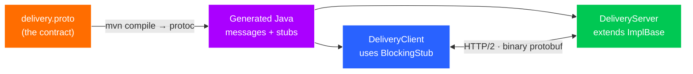

# Exercise 07 — gRPC

**Time:** ~60 min  **Port:** 9090  **Needs:** Maven  **You'll learn:** contract-first APIs with protobuf, generated stubs, unary vs streaming RPCs, gRPC status codes & deadlines

## The story
Inside QuickBite, the **Order service** asks the **Delivery service** "when will the rider arrive?" thousands of times a second. Nobody reads these calls in a browser, so we don't need human-friendly JSON. We want: small messages, a strict contract, generated client code, and streaming. That's gRPC — protobuf messages over HTTP/2.



## How gRPC Works — Core Concepts

### 1. Contract-First API with Protobuf
Unlike REST where schemas are often an afterthought (or documented in OpenAPI), gRPC is strictly **contract-first**:
* You define your data structures and service methods in a `.proto` file (`delivery.proto`).
* In Protobuf, fields use **field numbers** (`order_id = 1`, `minutes = 2`), not string names on the wire.
* The protobuf compiler (`protoc`, executed automatically during `mvn compile`) generates the Java classes (`EtaRequest`, `EtaReply`, `DeliveryServiceGrpc`). You never write manual JSON serializing or deserializing code.

### 2. Binary Wire Format vs JSON
* **JSON**: Serializes keys and values as human-readable ASCII text (`{"order_id":"ord_1","minutes":10,"rider_name":"Ravi"}`). Delimiters, colons, quotes, and repetitive key names consume ~51 bytes.
* **Protobuf**: Serializes keys as compact binary tags (1 byte encoding `field_number` and `wire_type`) and numbers as variable-length binary integers (varints). The identical payload takes only **15 bytes** (over 70% smaller).

### 3. The 3 RPC Patterns in this Lab
1. **Unary RPC (`GetEta`)**:
   * One request $\to$ One response.
   * Works like an ordinary Java function call (`stub.getEta(request)`).
2. **Server-Streaming RPC (`TrackRider`)**:
   * One request $\to$ Stream of multiple responses over time.
   * Used for real-time progress updates, GPS location feeds, or large exports. The client iterates over the stream with a standard `Iterator<RiderLocation>`.
3. **Client-Streaming RPC (`UploadRoute`)**:
   * Stream of requests $\to$ One final response.
   * Used when a client uploads chunks of data or telemetry (e.g., rider phone streaming GPS coordinates during a trip, server summarizes total distance).

### 4. The `StreamObserver<T>` Pattern
In gRPC, asynchronous and streaming calls use `StreamObserver<T>` with three reactive callbacks:
* `onNext(value)`: Emits an item. Called once for unary, or multiple times for streaming.
* `onError(throwable)`: Terminates the RPC with an error status (e.g. `Status.NOT_FOUND`).
* `onCompleted()`: Signals that the stream has successfully finished. Must be called, or the client blocks waiting for more data.

### 5. Deadlines & Cancellation
* Distributed systems must prevent slow or hanging downstream services from freezing the caller.
* Every gRPC call can specify a deadline: `stub.withDeadlineAfter(2, TimeUnit.SECONDS)`.
* If the server takes too long, gRPC cuts the connection with `Status.DEADLINE_EXCEEDED`. The server can detect cancellation via `call.isCancelled()` and immediately stop doing wasted work.

| RPC | Shape | Real-world use |
|---|---|---|
| `GetEta` | request → response (**unary**) | a normal function call between services |
| `TrackRider` | request → **stream** of responses | live location, progress updates |
| `UploadRoute` | **stream** of requests → response | rider app uploading GPS points in bulk |
| *(bidi)* | stream ↔ stream | chat, multiplayer — not in this lab |

## Run it
```bash
mvn -q compile                     # generates code from the .proto (first run downloads protoc)
ls target/generated-sources/protobuf/java/lab/grpc     # go look at what was generated!
mvn -q exec:java                                       # terminal 1: server
mvn -q exec:java -Dexec.mainClass=lab.DeliveryClient   # terminal 2: client
```
Optional: if you have [grpcurl](https://github.com/fullstorydev/grpcurl), `grpcurl -plaintext -proto src/main/proto/delivery.proto -d '{"order_id":"ord_1"}' localhost:9090 quickbite.DeliveryService/GetEta`

## TODOs
| # | File | What |
|---|---|---|
| 1 | `DeliveryServer.getEta` | Unary: `onNext` + `onCompleted`, or `onError(NOT_FOUND)` |
| 2 | `DeliveryServer.trackRider` | Server streaming: 6 `onNext`s 500 ms apart, stop if cancelled |
| 3 | `DeliveryServer.uploadRoute` | *Stretch:* client streaming — return an observer that aggregates |
| 4 | `DeliveryClient.unary` | Call with a **deadline**, compare wire size vs JSON, handle `NOT_FOUND` |
| 5 | `DeliveryClient.streaming` | Iterate the stream; see a deadline cut it off mid-way |

## Expected client output (roughly)
```
=== 1. Unary: GetEta ===
Ravi arrives in 10 min
wire size: protobuf 15 bytes vs JSON 51 bytes
ord_999 -> NOT_FOUND: No trip for ord_999

=== 2. Server streaming: TrackRider ===
  2400 m left  (12.9352, 77.6245)
  1920 m left  (12.9356, 77.6249)
  ...
     0 m left  (12.9372, 77.6265)
  ord_2 stream ended with DEADLINE_EXCEEDED (deadline hit mid-stream)
```

## Think & answer

### 1. Protobuf put the reply in 15 bytes, JSON in 51. Where did the savings come from?
- **Field numbers instead of string keys**: JSON transmits field keys in full ASCII on every message (`"order_id"`, `"minutes"`, `"rider_name"` plus quotes, colons, and punctuation). Protobuf replaces field names with compact 1-byte tags encoding `(field_number << 3) | wire_type`.
- **Varints & Binary encoding**: Integers and timestamps are packed into binary varints (e.g. small integers take 1 byte instead of 4–10 ASCII characters).
- **No whitespace or delimiters**: Protobuf has no commas, curly braces, quotes, or spacing overhead.

### 2. Schema Evolution: Adding field 4 vs renumbering `minutes` from 2 to 5
- **Adding `string rider_phone = 4;`**: Safe and backward/forward compatible. Old clients that do not know field 4 simply ignore unknown field tags (stored in `UnknownFieldSet`) and deserialize fields 1, 2, and 3 without error. New clients parse field 4 normally.
- **Renumbering `minutes` from 2 to 5**: **Breaking change!** In Protobuf, the field number is the true identifier on the wire, not the variable name. Old clients expecting field 2 will find it missing (defaulting to 0) and will fail to read `minutes`. **Golden rule**: Never change or reassign an existing field number once deployed.

### 3. Why can't a browser call this gRPC server directly? What is gRPC-Web?
- Standard gRPC requires direct control over HTTP/2 transport framing — specifically **HTTP/2 trailers** (where gRPC passes `grpc-status` and error messages after the response body) and raw binary framing. Browser JavaScript fetch/XHR APIs do not expose low-level HTTP/2 frame control or streaming trailers.
- **gRPC-Web / Gateway**: An intermediary proxy (such as Envoy or grpc-gateway) translates browser-compatible HTTP/1.1 or standard HTTP/2 requests (which encode trailers in a custom framing or base64 stream) into standard gRPC HTTP/2 calls for backend services.

### 4. Why should every gRPC call carry a deadline? Cascading failures explained
- Without deadlines, if downstream service `C` hangs (e.g., due to a database deadlock or memory freeze), upstream service `B` blocks waiting on `C`, and service `A` blocks waiting on `B`. Threads and connection pools are rapidly exhausted across all services, causing a full cluster crash (**cascading outage**).
- gRPC propagates deadlines down the call tree via the `grpc-timeout` metadata header. If the deadline expires, the calls abort immediately, free up threads/resources, and return `DEADLINE_EXCEEDED`.

### 5. gRPC to HTTP status code mapping
| gRPC Status Code | HTTP Status Code | Meaning / Typical Scenario |
|---|---|---|
| `NOT_FOUND` | `404 Not Found` | Requested entity (order, rider) does not exist |
| `INVALID_ARGUMENT` | `400 Bad Request` | Client passed invalid parameters (e.g., negative minutes) |
| `UNAUTHENTICATED` | `401 Unauthorized` | Missing, expired, or invalid authentication token |
| `PERMISSION_DENIED` | `403 Forbidden` | Authenticated caller lacks permissions (RBAC / ACL) |
| `UNAVAILABLE` | `503 Service Unavailable` | Server overloaded, shutting down, or transient network blip |
| `DEADLINE_EXCEEDED` | `504 Gateway Timeout` | Operation exceeded allotted deadline before completing |

### 6. L4 vs L7 Load Balancing with HTTP/2 Multiplexing
- In HTTP/1.1, clients create and tear down many TCP connections, allowing an L4 (TCP-level) load balancer to distribute connections evenly across backend pods.
- In HTTP/2 / gRPC, a client opens **one single long-lived TCP connection** and multiplexes thousands of RPC calls over it.
- **The problem with L4 LB**: An L4 balancer only balances at TCP connection setup. All requests from a client will stay glued to that single server pod indefinitely, causing massive load imbalance (one pod at 100% CPU while others sit at 0%).
- **Solutions**:
  1. **L7 Proxy (Envoy, NGINX)**: Decodes HTTP/2 streams and load balances individual RPC requests to backends.
  2. **Client-side Load Balancing**: The gRPC client resolves multiple backend pod IPs (via DNS / headless service) and balances RPC calls across connection pools internally.

### 7. When to pick gRPC over REST (and when NOT to)
- **Pick gRPC when**:
  - High-throughput internal microservice-to-microservice (East-West) communication.
  - Streaming is needed (server push, client telemetry streaming, bidirectional).
  - Polyglot microservices where generated client stubs prevent contract drift.
  - Low latency, high CPU efficiency, and minimal network serialization overhead are critical.
- **Pick REST when**:
  - Public-facing APIs (North-South) consumed by external developers, third parties, and web browsers.
  - API needs to leverage HTTP caching (CDNs, browser caches via `Cache-Control`).
  - Human readability and easy debugging with standard tooling (`curl`, Postman, standard browser dev tools) are prioritized.

## Stretch
- Implement TODO 3 and run the client's section 3.
- Add a bidirectional `rpc Chat(stream ChatMessage) returns (stream ChatMessage)` and compare it with Exercise 04's WebSocket chat.
- Add a `ServerInterceptor` that logs method name + duration of every call (gRPC's version of a servlet filter).
